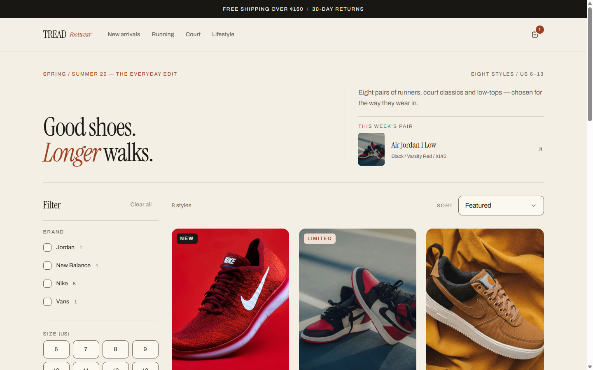
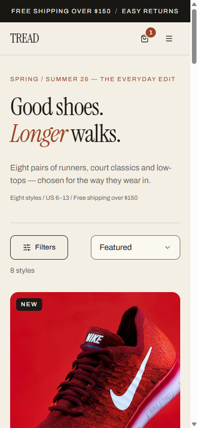

# DeepSeek Skills

A working pack of [DeepSeek Harness](https://deepseek-harness.github.io/) skills: one design family that covers web, desktop, mobile, print, slides and social, and one engineering family that audits code, queues, security, migrations, performance and releases.

Every skill is a **claim-check procedure**, not an essay. Each phase ends in a named artifact, and a check that was not executed is labelled `PLANNED` or `UNAVAILABLE` — never `PASSED`.

## Proof

Built with these skills in a separate session: a footwear storefront (React + Vite + Tailwind), screenshotted from a live dev server at `1440px` and `390px`. No retouching — these are direct `.screenshot()` output from the same run that produced the measurements below.



### Mobile, 390x844



### Measured in that run

| Check | Result |
|---|---|
| Console | 3 messages, **0 errors, 0 warnings** |
| Horizontal scroll at `390px` | none (`scrollWidth 375` against `innerWidth 390`) |
| Tap targets | `44px` minimum on the visible controls |
| Typography | Instrument Serif display, one accent (rust) on cream, ≤4 sizes above the fold |
| States | filter chips, sort select, `NEW`/`LIMITED` badges, cart count |

**What this does not prove.** A screenshot proves the *rendered frontend*. It does not prove the backend behind it — no API, database, or auth path was audited in that run. That claim needs `senior-app-security` + `senior-background-jobs` + `stack-php-mysql` against the actual code, with commands and output, not an image.

## Structure

```
dsh-deepseek-skills/                      installable DSH bundle — this repository root
├── package.json                          dsh.bundle.patch -> cordis.patch.yml
├── cordis.patch.yml                      inserts this package into the profile
├── index.js                              composes the two plugins and the folder skills
│
skills/                                   folder skills, registered by index.js
├── creative-designer/                     universal design method + per-medium constraints
├── ui-design/                             web visual craft: tokens, 8 states, screenshot loop
├── senior-frontend-engineering/           React correctness, WCAG 2.2 AA, CWV, Playwright
├── stack-index/                           any language -> its executable command set
├── stack-python/                          Python command set with a verification log
├── stack-php-mysql/                       Laravel/PHP + MySQL + Redis + Windows commands
├── senior-app-security/                   authz/IDOR, mass assignment, XSS, CSRF, CSP
├── senior-background-jobs/                queues, Horizon, retries, failed_jobs, cron
└── senior-production-defaults/            never ship the scaffold: build-time defaults

plugins/                                  the two original plugin packages
├── dsh-deepseek-harness-skills/           sandbox-mode, plannable, organizer (+ prompts, references, tools)
└── dsh-senior-engineering-skills/         11 senior-* audit skills (+ prompts, tools)
```

## The design family

| Skill | Covers |
|---|---|
| `creative-designer` | Medium-agnostic method, shared system, and constraint sets for desktop, mobile, print/PDF, slides and social. Any medium not listed is derived from four questions. |
| `ui-design` | Web: tokens, spacing rhythm, the eight component states, the "AI look" rejection list, a pass/fail rubric, and the screenshot-critique loop. |
| `senior-frontend-engineering` | React state ownership and rendering correctness, WCAG 2.2 AA, Core Web Vitals budgets, browser-level proof (Playwright, visual regression), client security and i18n. |

## The engineering family

| Skill | Covers |
|---|---|
| `senior-code-review` | Correctness, failure behaviour, concurrency, security, tests, interface compatibility |
| `senior-work-audit` | Claim → ground truth → execution → diff audit → verdict |
| `senior-test-adequacy` | Revert-falsification, diff coverage, mutation survival, determinism |
| `senior-data-migration-safety` | Expand/contract ordering, lock impact, backfill, restore drill |
| `senior-performance-audit` | Baseline, USE, profiling, query plans, overload/soak, re-measurement |
| `senior-reliability-review` | SLIs/SLOs, error budgets, alert quality, runbooks, postmortems |
| `senior-release-gate` | Artifact identity, verification evidence, rollback, observability, go/no-go |
| `senior-system-hardening` | Identity, secrets, network exposure, host/container baselines, drift |
| `senior-supply-chain-audit` | Dependency graph, lockfile integrity, provenance, CI permissions |
| `senior-threat-model` | DFD, trust boundaries, STRIDE/LINDDUN/LLM threats, ranked mitigations |
| `senior-architecture-review` | Attribute trade-offs, ADRs, interface contracts, data ownership |
| `senior-app-security` | Object-level authorization, mass assignment, validation, XSS, CSRF/CORS, abuse controls |
| `senior-background-jobs` | Delivery semantics, idempotency, retries, failed_jobs, scheduler, worker ops |

## Stack bridge

The engineering skills are stack-neutral, which is how they end up citing PostgreSQL and Kubernetes. `stack-php-mysql` supplies the executable substitute for a Laravel/PHP + MySQL + Redis + Windows project, so an evidence gate resolves to a real command instead of `UNAVAILABLE`. Each senior skill points to it.

## Requirements

- DeepSeek Harness **0.2.1-rc.1 or newer**
- Node.js and pnpm only for installing the plugin packages
- Optional: Playwright or the devtools MCP server for the screenshot-critique loop

## Install

### As a DSH plugin — one step

Point the DSH plugin installer at the repository URL:

```
https://github.com/RHKfullstack/DEEPSEEK-SKILLS.git
```

The repository root is itself a bundle (`package.json` → `dsh.bundle.patch` → `cordis.patch.yml`), and `index.js` composes:

- `sandbox-mode`, `plannable`, `organizer` — with their policy sections and `references/`
- the eleven `senior-*` audits — with the senior policy section
- the eight folder skills under `skills/`

23 skills in one install. No sub-package paths, no second install.

> **Fixed in 1.1.0.** Earlier commits failed with *"This package declares no bundle, so it cannot be managed as a plugin"* — the root had no `package.json`, so the installer had nothing to mount.

### As folder skills only

Copy `skills\*` into `~/.dsh/skills/`. The filesystem provider picks them up on the next turn, with no restart. Use this when you want the design and stack skills without the plugin machinery.

Full per-tool instructions, including Claude Code and the other agents, are in [INSTALL.md](INSTALL.md). Short version: copy `skills/*` into `~/.dsh/skills/` (picked up on the next turn, no restart), and install the two plugin packages under a DSH profile with `pnpm`.

## Notes

- Skills are loaded on demand by matching the catalog description against the task. The always-on set is declared by the plugin, not by this README.
- These files are instructions for an agent. They do not add code to an application and they are not a dependency of one.
- The pack was written and iterated against real work; the "Failure modes" sections are distilled from mistakes that actually happened during that work.
